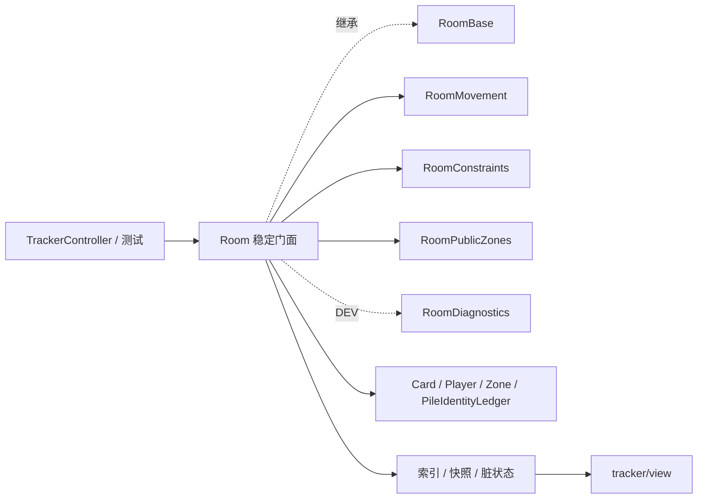

# Room 单局状态容器（渐进式披露）

> 当任务涉及 `src/tracker/Room.ts`，需要判断状态应由谁持有、入口应放在 Room 还是行为模块、
> 或排查单局初始化、移动、收敛、索引同步与销毁问题时，按需阅读本文。
> 只想调用现有能力时先查 [`tracker_api.md`](tracker_api.md)；应用级创建、View 挂载与销毁时序见
> [`lifecycle.md`](lifecycle.md)；GameState 统一单局状态仓库及 Room 访问入口见
> [`skill_state.md`](skill_state.md)。

## 阅读路由

移动端点契约与调用示例见 [tracker_api.md](tracker_api.md)。
当前入口为 `moveCards(cardIDs, request)`，request 的只读 `from/to` 是唯一端点描述；
上下文只额外保存移动前手牌快照和阶段结果。协议事件同样在顶层携带端点。

| 当前任务                        | 建议阅读                                                                                                | 说明                                                    |
| ------------------------------- | ------------------------------------------------------------------------------------------------------- | ------------------------------------------------------- |
| 快速理解 Room 的职责与主流程    | 本文第一至四层                                                                                          | 单局状态源、生命周期、状态所有权、写入管线              |
| 查找读取、移动、揭示或物化 API  | [`tracker_api.md`](tracker_api.md)                                                                      | 稳定公开入口与调用示例                                  |
| 修改 `Card` / `Player` / `Zone` | [`card_player_model.md`](card_player_model.md)                                                          | 实体字段、候选主模型、玩家投影与公共区顺序              |
| 修改约束或排查不收敛            | [`card_tracker_convergence.md`](card_tracker_convergence.md)                                            | 不动点、数量约束、`changed` 契约与性能护栏              |
| 处理匿名槽、物化、洗牌身份      | [`card_tracker_anonymous_pile.md`](card_tracker_anonymous_pile.md)                                      | cohort/generation、身份分区与 `PileIdentityLedger`      |
| 处理技能或协议特例              | [`card_tracker_skills.md`](card_tracker_skills.md) / [`../protocols/README.md`](../protocols/README.md) | 技能装饰、协议字段样例与特殊移动语义                    |
| 使用技能临时状态                | [`skill_state.md`](skill_state.md)                                                                      | GameState 统一仓库、命名空间、Room 薄入口与当前技能清单 |
| 排查 Room 创建、挂载或销毁      | [`lifecycle.md`](lifecycle.md)                                                                          | Controller、Room、View 的应用级时序                     |
| 选择回归命令或补测试            | [`testing.md`](testing.md)                                                                              | tracker 测试、类型检查、lint 与构建                     |

## 第一层：先建立最小模型

`Room` 是一局牌局的状态权威和稳定门面，不是全局单例、原始协议解析器或 DOM 视图。

- 浏览器运行时由 `TrackerController` 创建并持有当前 Room；业务代码通常通过
  `tracker.getReadyTrackerRoom()` 获取已完成牌堆初始化的实例。
- 测试优先使用 `tests/tracker/helpers/room.ts` 的 `createTestRoom()`，避免重复手写初始化步骤。
- `Room` 持有单局事实、身份分区、约束与派生索引；状态写入统一经 Controller 或 Room 公开入口。
- `src/tracker/room/index.ts` 显式导出行为类及对外类型，供目录外调用方统一导入；接口与类型别名使用
  `export type`，定义仍留在所属模块。目录内部继续就近导入定义文件，移动阶段的内部辅助类型保留在 `movement/types.ts`。
  聚合入口显式写为 `@/tracker/room/index` 或相对路径 `./room/index`，与单局容器 `src/tracker/Room.ts` 的入口区分。
- `Room` 单层继承 `room/RoomBase.ts`，由基础类提供座位、视角、对局上下文和技能状态访问入口。
  这些字段仍属于同一个 Room 实例；玩家注册、视图脏通知、GameState 绑定和销毁协调保留在 Room。
- `RoomMovement`、`RoomConstraints`、`RoomPublicZones` 与 `RoomIdentity` 只持有 Room 引用并执行分阶段行为，
  不拥有另一套独立推断状态。`PlayerSnapshot` 独占玩家区派生缓存，`RoomMoveEvents` 独占处理器注册表。
- `RoomDiagnostics` 仅在 DEV 环境挂载，集中执行只读断言与收敛告警；仅维护诊断抽样状态，
  不参与牌局状态写入。Room 保留公开断言薄入口，生产环境保持空操作。
- `resolveConstraints()` 是稳定投影边界：候选与物理状态写入后，经它收敛并同步索引、玩家视图组、
  计数器和一致性检查。

## 第二层：单局生命周期

| 阶段       | 核心入口                                          | Room 状态                                                                                                                                       |
| ---------- | ------------------------------------------------- | ----------------------------------------------------------------------------------------------------------------------------------------------- |
| 构造       | `new Room({ gameState })`                         | 创建公共 `Zone`、行为模块、约束/索引容器与身份账本，并绑定本局 `GameState`；此时还没有可运行牌堆                                                |
| 注册座位   | `registerPlayers(infos, currentUserID)`           | 重建 `players`、`seatIDs`、`size`，识别 `mySeatID`，同步录像状态与固定视角前置数据                                                              |
| 初始化牌堆 | `initDeck(cardIDs)`                               | 清空旧牌池，创建等量匿名物理槽，登记真实身份，初始化 generation 0、索引、快照与 `CardCounter`，最后置 `isDeckReady = true`                      |
| 对局运行   | `moveCards()` / `shufflePile()` / reveal 相关入口 | 更新物理实体、身份账本、候选与手牌数事实，再执行收敛和派生同步                                                                                  |
| 销毁       | `destroy()`                                       | 与 `GameState` 解绑并触发统一临时状态清理，再清空玩家、Zone、牌实体、约束、身份分区、脏状态和座位信息；整个实例随即失效，不再被 Controller 复用 |

浏览器侧可能在玩家注册后进行一次早期 View 挂载，但只有 `initDeck()` 完成后 Room 才能通过
`getReadyTrackerRoom()` 对外提供完整记牌能力。具体挂载时序不要在 Room 内推断，见
[`lifecycle.md`](lifecycle.md)。

Room 解绑只清理 Room 关联状态与统一临时状态仓库，不清理 Game 持有的对局 ID、模式和
`needShowName`，避免旧 Room 销毁时擦除先到的新局初始化信息；这些信息随对局重置或结束清理。
Controller 每次创建 Room 后、注册座位前调用 `Game.beginPlayback()`，重置本轮运行状态并按
保留的模式名称重新应用模式默认值。同一录像重新播放也创建新 Room，不能仅凭相同 `gameId`
跳过播放状态重置。

## 第三层：Room 持有什么

### 权威事实

| 分区         | 代表字段                                                                             | 语义                                                                                |
| ------------ | ------------------------------------------------------------------------------------ | ----------------------------------------------------------------------------------- |
| 座位与视角   | `players`、`seatIDs`、`size`、`mySeatID`、`firstID`                                  | 本局玩家集合、主视角与固定显示顺位前置事实                                          |
| 物理牌实体   | `cards`、`zones`、`cardIndex`                                                        | 物理实体、公共区有序关系与正 ID 索引；历史 suspended 展示实体仍登记于 `cards`       |
| 范围身份载体 | `detachedKnownCards`、`trackedCards`                                                 | 公共范围揭示不增加 `cards`；`trackedCards` 合并物理实体与范围身份，供推断和投影读取 |
| 身份分区     | `deckIdentities`、`unlocatedIdentities`、`suspendedKnownCards`、`pileIdentityLedger` | 暗牌堆真实身份集合、未定位身份、暂停展示实体与 cohort/generation 权威账本           |
| 推断约束     | `constraintGroups`                                                                   | 局部位置/数量约束                                                                   |
| 技能临时账本 | GameState `tracker` scope（经 `read/ensure/set/deleteSkillState` 访问）              | 当前 Room 的技能推断状态；存储和生命周期由 GameState 统一管理                       |
| 扩展注册表   | `RoomMoveEvents` 的技能插件、`skillHandlers` 与旧装饰入口读面                        | 技能生命周期与单牌定位扩展；随 Room 销毁，不跨局复用状态                            |

### 派生状态与缓存

| 分区         | 代表字段                                                         | 更新方式                                                                                   |
| ------------ | ---------------------------------------------------------------- | ------------------------------------------------------------------------------------------ |
| 位置投影     | `locationIndex`                                                  | `resolveConstraints()` 消费卡牌脏事件和公共区脏集合，断档时全量重建                        |
| 模糊明牌反查 | `ambiguousKnownIndex`                                            | 通常增量更新；约束组结构变化时全量重建                                                     |
| 计数查询     | `counter`                                                        | `initDeck()` 后创建，收敛尾部按脏牌增量更新                                                |
| 玩家区快照   | `PlayerSnapshot` 内部数组、成员集合、游标与创建顺序              | Room 保留 `playerCardsSnapshot` 只读 getter；按 `dirtyCardEvents` 增量刷新，断档时回退全量 |
| View 脏状态  | `viewDirty`、`dirtyCards`、`dirtyCardEvents`、`dirtyPublicZones` | 由卡牌/Zone 变更入口记录，供索引和视图各自按游标消费                                       |

派生数组、索引桶和快照都不是写入事实。不要直接修改 `locationIndex`、
`Player.knownHandCards`、`Player.candidateHandCards` 或其它视图分组。

## 第四层：状态写入管线

### 普通协议移动

`src/handler/PubGsCMoveCard.js` 负责入口过滤、局流、计数、特殊区域和称象 UI 状态采集。
特殊区域处理器只更新状态并返回 `{ handled }`，控制是否跳过普通副作用；所有有效路径均由
`handleMoveCard()` 末尾统一调用 `syncTrackerMove()`，不向处理器传递提交回调。
`TrackerController.syncTrackerMove()` 复制 raw/patched，冻结原始快照，再执行位置规范化、
`Room.beforeNormalizeMove()` 补牌、明暗数量校验、一次归一化及 `decorateMoveEvent()`。
领域事务成功后才发送 `afterMoveCommitted()` 和公开 ID 通知；延迟、noop、来源失败及异常不发送
成功通知。Controller 直调同样运行补牌；入口过滤保留在 Handler，Controller 仍支持零张洗牌。
Handler 不直接修改 `Card`、`Zone` 或玩家投影。

`Room.moveCards()` 保留高频主流程，阶段细节委托给 `RoomMovement`：

1. `createMoveContext()` 统一已知 ID、物理数量、来源/目标、手牌差量和特殊选项；`RoomIdentity.capturePileMoveSnapshot()` 保存移动前牌堆数量及常规摸牌的可见端点。
2. 对必须匿名化的模糊来源实体先整批预检，避免产生半完成状态。
3. 写入来源与目标手牌总数差量，并在整手揭示前置处理暗置标记候选。
4. 解析已知牌，必要时物化匿名槽；传播候选，再分别移动匿名牌和已知牌。
5. 写入公共位置候选或局部 `ConstraintGroup`。
6. `RoomIdentity.commitPileIdentityForMove()` 提交身份账本并投影 cohort；随后调用 `resolveConstraints()`，稳定所有派生状态并执行最终一致性检查。

普通移动的数量快照、身份事件构造和提交都由 Room 内聚。Controller 仅透传 `pileIdentityEvent`
提供最终协议事实；技能的 `pileIdentityCardIDs` 优先于协议 ID。领域直调无需伪造协议，使用移动上下文
推导账本区域和身份。匿名化预检失败时不修改实体、手牌总数或账本，也不提交事务。

移动的端点取牌、公共候选、随机手牌转移和已知/匿名置换细节，应继续下钻到
`src/tracker/room/movement/RoomMovement.ts`、`src/tracker/room/movement/` 及对应协议/技能文档。

### RoomMovement 内部组合

`RoomMovement` 不再通过多层继承拼接行为，而是在构造时创建以下职责组件：

| 组件 / 文件                                                          | 职责与依赖                                                                                                          |
| -------------------------------------------------------------------- | ------------------------------------------------------------------------------------------------------------------- |
| `createMoveContext()` / `room/movement/context.ts`                   | 无状态地解析移动参数并快照移动前来源手牌事实；不持有缓存，独立于协议事件归一化                                      |
| `RoomMovementSources` / `room/movement/sources.ts`                   | 来源定位、取牌、占位置换和手牌差量；仅通过 `HiddenMarkPlaceholderAccess` 调用标记占位查找、移除与替换               |
| `RoomMovementUnknownPlacement` / `room/movement/unknownPlacement.ts` | 未知身份移动阶段；保留玩家目标与公共目标各自的缺口处理语义，不假设未知来源实体必为匿名牌                            |
| `RoomMovementKnownSources` / `room/movement/knownSources.ts`         | outside、公共端点、玩家子区三路已知牌解析与整批身份确认；复用 Room 身份原语与来源查询                               |
| `RoomMovementKnownPlacement` / `room/movement/knownPlacement.ts`     | 已知牌来源校正、逐牌技能/落区与旧公共槽回补；复用来源置换和标记组件，不复制规则                                     |
| `RoomMovementCandidates` / `room/movement/candidates.ts`             | 随机手牌转移、公共候选传播和局部约束维护；不持有来源或标记组件                                                      |
| `RoomMovementHiddenMarks` / `room/movement/hiddenMarks.ts`           | 暗置标记、装备容器位置解析、木牛与标记槽守恒；通过共享查询取得来源占位，不反向依赖来源组件                          |
| `room/movement/equipmentMarks.ts`                                    | 装备容器座位投影、目标/迁座识别、稳定记录键与全明快照判定；只读传入的实体索引、观测座位和移动上下文，不访问标记账本 |
| `room/movement/sourceQueries.ts`                                     | 无状态的候选读取、手牌查询与未知来源筛选；精确来源优先，同类实体保持原有顺序                                        |

所有组件仍写入同一个 Room；标记账本仍通过 `Room.ensureSkillState()` 保存在按局隔离的 GameState 中。
共享查询实时读取 Room / Card，不保存快照，不移动实体，也不初始化标记账本。

两个已知牌组件由 RoomMovement 私有持有，`resolveKnownMoveCards()` 只编排来源解析与整批确认，
`moveKnownCardsForContext()` 只编排批次准备、逐牌处理与落区收尾。来源解析结果和置换诊断仅随
本次调用传递，不保存跨协议缓存；玩家来源校正、技能回调和目标绑定保持逐牌执行，不能整批重排。
公共目标先修复旧公共槽再批量插入，同批已知牌不可互相充当回补占位。

`Room.resolveEquipmentContainerLocationCandidates()` 保留为索引使用的公开入口，直接委托给
`movement.hiddenMarks`。该组件读取 `HiddenMarkState.muniuMarkSeat` 并交给 `equipmentMarks.ts`
计算位置；Room 不依赖标记账本内部结构，规则模块也不读取或初始化账本。
装备映射和 container 候选构造仍在 `candidate/equipmentMarkContainer.ts`，没有增加第二套注册表。
`hiddenMarks.ts` 保留迁座、记录结算、占位维护和约束重建的协调顺序，单向调用装备规则；
规则只返回判定结果，不回调暗置标记组件，不另建木牛状态仓库。

Room 保留原有移动阶段顺序与最终收敛边界。RoomMovement 本身只实现移动阶段，不为组件或查询
增加同名转发方法。细分行为直接通过只读组件引用调用：

- `room.movement.sources`：来源操作与手牌差量。
- `room.movement.candidates`：随机转移与公共区候选传播。
- `room.movement.hiddenMarks`：标记揭示、占位迁移与守恒协调。
- 纯读取直接从 `room/movement/sourceQueries.ts` 导入，显式传入 Room。

`RoomMovementUnknownPlacement` 与两个已知牌组件一样由 RoomMovement 私有持有，只能经
`moveUnknownCardsForContext()` 阶段入口调用。

组件引用在构造后不可替换；不要把已移除的包装搬到 Room，或用 getter、绑定函数重新建立转发层。

### 约束收敛与稳定尾部

`Room.resolveConstraints()` 保留为稳定公开入口，直接委托 `RoomConstraints.resolveConstraints()`。
不动点循环和消费分配结果的 `reconcileAnonymousHandCards()` 集中在 `room/constraints.ts`；
手牌分配统一由 `constraint/handSlotUsage.ts` 的 `computeHandSlotAllocation()` 计算。
E1/E2 座位缓存不由 Room 实现，只在单次求解内存活。
Room 仍持有权威状态、`resolveTouchedSeats`、收敛轮数与脏事件，DEV 诊断实例通过入口按需传入，
不公开诊断字段，也不在约束模块复制状态。

`resolveConstraints()` 的概念顺序是：

1. 从完整位置候选同步确定 owner。
2. 收敛局部 `ConstraintGroup`。
3. 根据观测手牌数执行暗牌额度与排他约束。
4. 对账需要创建或释放的匿名手牌实体，直到达到不动点。
5. 暂停候选范围过宽的明牌。
6. 更新 `locationIndex`、玩家视图组、`ambiguousKnownIndex` 与 `CardCounter`。
7. 执行玩家快照、索引、公共区、实体与身份守恒断言。

终止性、触碰座位缓存、脏事件游标和 `changed` 幂等契约统一见
[`card_tracker_convergence.md`](card_tracker_convergence.md)。

### 洗牌

`shufflePile()` 不是普通 `moveCards()` 的简单组合。真实弃牌洗回时必须先让
`PileIdentityLedger` 原子提交 generation 过渡，再委托 `RoomIdentity` 按提交结果处理旧世代身份暂停与
cohort 身份到匿名实体的投影，并协调洗回身份匿名化和物理牌堆重建；
最终物理张数以协议 `CardCount` 为准，身份候选独立保留。匿名槽补足/退出委托给
`RoomPublicZones.resizeShuffledPile()`；通常只随机弃牌部分，保留原剩余牌堆相对顺序。
`RoomIdentity` 集中实现 `anonymizePileCohortIdentityEntities()`、
`suspendUnresolvedPileIdentitiesForShuffle()` 与内部的 `createDetachedSuspendedIdentity()`，
不提交世代事务，也不持有独立身份状态。Room 保留账本事务调用、洗牌阶段顺序与最终收敛/断言。
完整语义见
[`card_tracker_anonymous_pile.md`](card_tracker_anonymous_pile.md)。

### 高风险移动边界

以下边界会同时影响物理槽、候选与身份守恒，只在相关任务中继续下钻：

- `materialize()` 只能接管合适的匿名槽、同 ID 端点实体或可恢复的 outside/suspended 身份，
  不能用未定位身份覆盖另一张正 ID 暗公共实体。
- 公共区已知牌物化只在本次协议 `cardCount` 覆盖的端点范围内分配匿名槽；不能穿透正 ID 暗端点
  扫描更深处的牌，也不能把同批后一张牌回塞到前一张已经消费的物理位置。
- 公共区无 CardIDs 的匿名移动通常只消费匿名槽；牌堆路径不得仅因已知实体位于端点就推断其
  身份失效。弃牌堆 `MoveType=18` 及移入玩家区的 `MoveType=15` 对未知获得创建负 ID 占位；
  其余非牌堆公共区移动遵守真实端点语义。
- 玩家来源明牌移入公共区而旧公共槽仍占位时，回补必须服从确定来源和同批隔离，不能让同批
  已知牌互相充当占位，也不能用实体数组顺序提前裁决跨座位随机候选。
- `seats.size === 1` 只说明 owner 已确定；若完整位置仍可能是同一玩家的手牌或标记区，必须继续
  保留子区域候选，不能直接落定。

匿名端点、置换、物化与洗牌的完整守恒规则见
[`card_tracker_anonymous_pile.md`](card_tracker_anonymous_pile.md)；随机手牌、暗置标记和技能特例见
[`card_tracker_skills.md`](card_tracker_skills.md) 及具体协议专页。

## 第五层：新增逻辑应放在哪里

| 变更类型                                                 | 首选位置                                                | 原因                                                                          |
| -------------------------------------------------------- | ------------------------------------------------------- | ----------------------------------------------------------------------------- |
| 入口过滤、局流计数与 UI 状态采集                         | `src/handler/PubGsCMoveCard.js`                         | 不保存 tracker 推断状态，不维护移动后回调                                     |
| 技能补牌、成功提交通知与非移动协议推断                   | `src/tracker/skill/` 的 `RoomSkillPlugin`               | 通过 Room 访问领域状态，Controller 只编排通用阶段                             |
| 归一化移动同步、Room 创建/销毁与运行时同步               | `src/tracker/runtime/bridge.ts`、`trackerController.ts` | 连接 handler、Room 与生命周期                                                 |
| `moveCards()` 某个低频阶段或来源取牌规则                 | `room/movement/RoomMovement.ts` / `room/movement/*`     | 保持 Room 中的高频主流程短而稳定                                              |
| 不动点收敛、手牌槽缓存、匿名手牌对账、约束组与稳定态同步 | `room/constraints.ts`                                   | 集中维护求解和稳定投影规则；Room 保留公开收敛入口与状态所有权                 |
| 公共区查询、牌序读面、一致性诊断                         | `room/publicZones.ts`                                   | 避免在 Room 重复实现 Zone 遍历                                                |
| 座位/视角字段与查询、GameState 上下文、技能状态访问      | `room/RoomBase.ts`                                      | 单层基础类，不依赖完整 Room；不创建独立技能状态仓库                           |
| 玩家区快照、事件游标、实体创建顺序                       | `projection/playerSnapshot.ts`                          | 唯一派生缓存，Room 保留查询和刷新入口                                         |
| 插件注册、阶段分发及输入类型                             | `room/moveEvents.ts`、`skill/protocolEvents.ts`         | 注册表按局隔离，移动与非移动事实使用各自的类型契约                            |
| 身份物化、匿名化、外部/suspended 实体创建与世代身份投影  | `room/identity.ts`                                      | Room 保留状态所有权、账本事务协调、公开原语及成功解绑后的诊断；不复制身份账本 |
| DEV 身份/槽位守恒、玩家快照、影子索引断言与收敛告警      | `room/diagnostics.ts`                                   | 只读检查，保留 Room 公开薄入口；抽样计数随初始化/销毁重置                     |
| 稳定且高频的单局公开入口                                 | `Room.ts` 的薄门面                                      | 便于调用方检索与引用追踪                                                      |
| 技能专属事件装饰与临时账本                               | `src/tracker/skill/` + GameState `tracker` 状态         | 技能状态按局隔离，Room 仅提供领域访问入口                                     |
| 牌实体、玩家事实或公共区模型语义                         | `model/Card.ts` / `model/Player.ts` / `model/Zone.ts`   | 由对应模型维护自身不变量                                                      |
| DOM、挂载、渲染合并与显隐                                | `src/tracker/view/` / `src/ui/`                         | Room 只记录可供视图消费的状态与脏事件                                         |

`RoomIdentity.anonymizeMoveSourceCards()` 负责模糊来源实体的整批预检与身份解绑，
`anonymizeRandomPileReturn()` 在已知/未知移动路径汇合后转换随机回堆实体；
Room 继续负责相应的 `PileIdentityLedger` 事务和阶段顺序。

新增内部辅助方法时，先判断它是在维护 Room 的权威状态，还是某个行为阶段的实现细节。后者优先放入
对应行为模块，再由 Room 暴露必要的薄入口。

新实体统一通过 `Room.registerCardEntity()` 追加到 `cards`，同时为 `PlayerSnapshot` 和
`CardLocationIndex` 登记创建顺序；该原语不移动牌、不发脏事件，也不写身份分区。
初始化牌堆、外部实体创建及历史 detached suspended 实体均使用此入口，避免首次入手时扫描全牌池找顺序。
公共范围揭示使用 `revealPublicCandidates()` / `ensureDetachedKnownIdentity()`，通过
`registerDetachedKnownCard()` 登记于独立集合及派生顺序，不追加物理实体。后续有精确匿名来源时，
`materialize()` 在原匿名槽上物化并回收载体、迁移约束引用；匿名手牌对账会保留范围身份需要的物理槽，
范围落定后再接管。没有合法匿名端点的纯揭示保留范围候选，不能新增实体或覆盖另一正 ID。

`RoomMoveEvents` 通过唯一 ID 注册 `RoomSkillPlugin`，重复 ID 报错。移动阶段通配插件先执行，
再按动作技能与端点派生的旧回调技能顺序匹配，同一插件最多执行一次；`registerMoveEventHandler()` 是装饰阶段的
兼容适配入口。`decorateMove` 只接收完整 `NormalizedMoveEvent`，不补造协议、数量或选项；
空返回或异常保留上一事件。`beforeNormalizeMove` 返回 `defer` 立即中止；前置/协议异常向上传递，
提交后通知逐插件隔离异常。`notifyCardsRevealed()` 广播去重后的正 ID。

`dispatchSkillProtocolEvent()` 分发使用技能、目标通知、选择回复与角色数据，返回待续交移动；
Controller 负责沿普通移动管线提交。`onDeckInitialized` 广播给插件清理相关状态，销毁统一清理
插件及旧注册表。领域直调仍使用 `Room.moveCards()`，不隐式触发协议插件，避免内部补偿重复通知。
测试用 `protocolMove()` 构造完整消息；协议端到端测试使用 Controller，低层阶段测试可直接调用 Room。

## 第六层：核心不变量与修改护栏

- `Room` 只代表一局；GameState 中的 tracker 临时状态、事件处理器、身份账本和索引不能跨 Room 复用。
- `Room.cards` 是物理实体集合，不等于仍未出现的真实身份集合；生产 `initDeck()` 只创建匿名槽。
- `Zone` 只表达公共区有序关系；玩家区事实由 `Card.location === 'player'` 与完整位置候选表达。
- `Card.locationCandidates` 是完整位置候选主模型；`seats`、子区候选和公共候选是投影。
- `isKnown`、真实 CardID、位置确定是三个不同维度，不能互相推导。
- 普通状态变更必须进入脏事件链；候选缩小时保留 `previousSeats`，否则增量收敛与索引会漏更新。
- 低层候选或实体写入后，在读取稳定索引/玩家视图组前调用 `resolveConstraints()`。
- 不要直接向 `room.cards`、玩家投影数组或索引桶 `push`；不要用 `Zone.add()` 代替协议移动。
- 物化已有身份优先使用 `materialize()`；不要为同一真实 ID 另建一张 `Card`。
- 洗牌必须保持身份账本事务先于物理区重建，不能绕过 generation 与 Room/ledger 一致性检查。

## 第七层：按症状诊断

| 症状                                             | 优先检查                                                                                                 |
| ------------------------------------------------ | -------------------------------------------------------------------------------------------------------- |
| `room` 为 `null`、牌堆未就绪或 View 挂载顺序异常 | [`lifecycle.md`](lifecycle.md) 与 `TrackerController`                                                    |
| 牌从错误端点取出、落错区或物理数量不符           | `Room.moveCards()`、`RoomMovement`、[`card_player_model.md`](card_player_model.md)                       |
| 正 ID 重复、匿名槽丢失、洗牌后身份异常           | [`card_tracker_anonymous_pile.md`](card_tracker_anonymous_pile.md)                                       |
| 候选过度收敛、欠收敛、轮数异常或遍历上涨         | [`card_tracker_convergence.md`](card_tracker_convergence.md)                                             |
| Room 状态正确但 UI 未刷新或分组陈旧              | `dirtyCardEvents`、`dirtyPublicZones`、`locationIndex`、`src/tracker/view/`                              |
| 只有某个 className / SpellID 出错                | [`../protocols/README.md`](../protocols/README.md) 与 [`card_tracker_skills.md`](card_tracker_skills.md) |

## 源码入口

- `src/tracker/Room.ts`：稳定门面、单局状态、生命周期与高频主流程。
- `src/tracker/room/RoomBase.ts`：座位、视角和对局上下文基础类；提供继承的技能状态访问方法。
- `src/tracker/room/movement/RoomMovement.ts`、`src/tracker/room/movement/`：移动阶段实现。
- `src/tracker/room/constraints.ts`：约束、暂停追踪与玩家视图组同步。
- `src/tracker/room/publicZones.ts`：公共区查询与一致性诊断。
- `src/tracker/room/diagnostics.ts`：DEV 断言、影子索引抽样与收敛轮数告警。
- `src/tracker/projection/playerSnapshot.ts`：玩家区增量快照及顺序缓存。
- `src/tracker/room/moveEvents.ts`：处理器注册、装饰顺序与事件类型契约。
- `src/tracker/room/identity.ts`：物化、匿名化、已有身份接管及外部实体创建。
- `src/tracker/runtime/trackerController.ts`：Room 创建、协议同步、揭示、渲染调度与销毁。
- `src/tracker/model/Card.ts`、`model/Player.ts`、`model/Zone.ts`：Room 持有的核心领域模型。
- `src/tracker/PileIdentityLedger.ts`：匿名牌堆身份事务权威。

修改 Room 或其行为模块后，按 [`testing.md`](testing.md) 运行 tracker 回归、类型检查、lint 与 build；
仅修改本文档及阅读路由无需构建。
